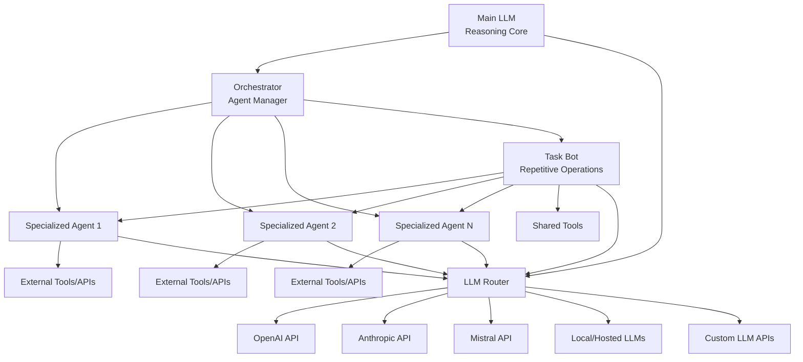
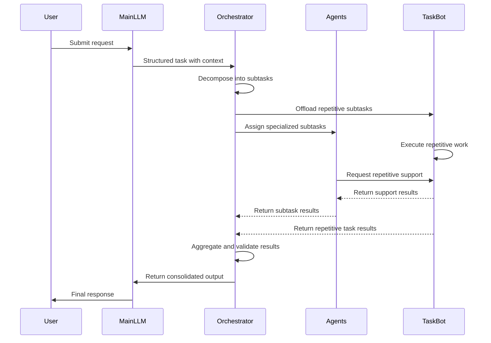
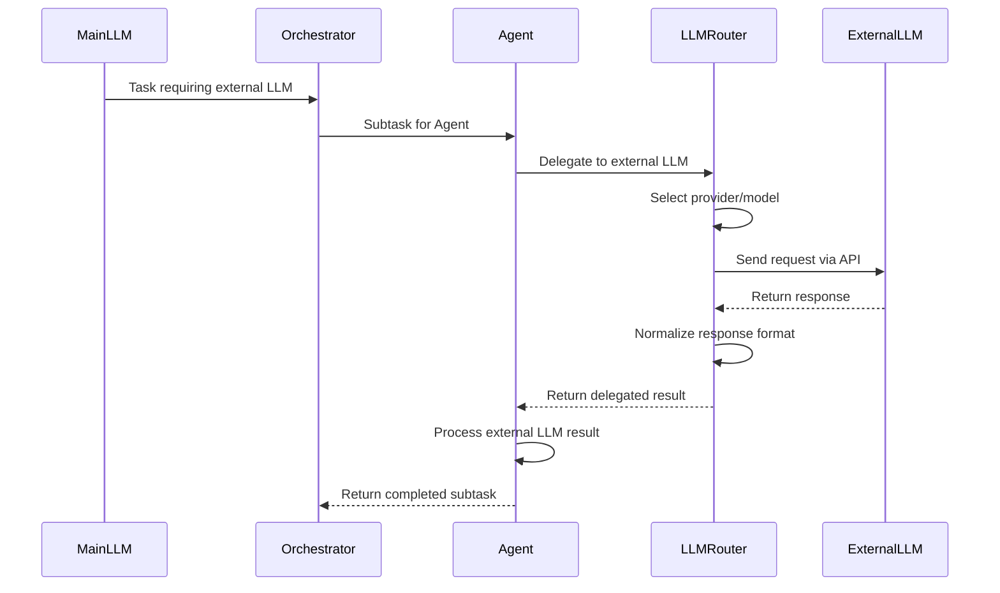
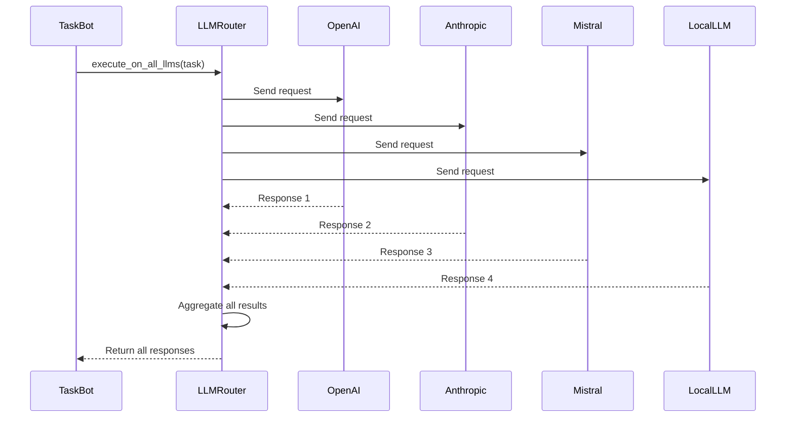
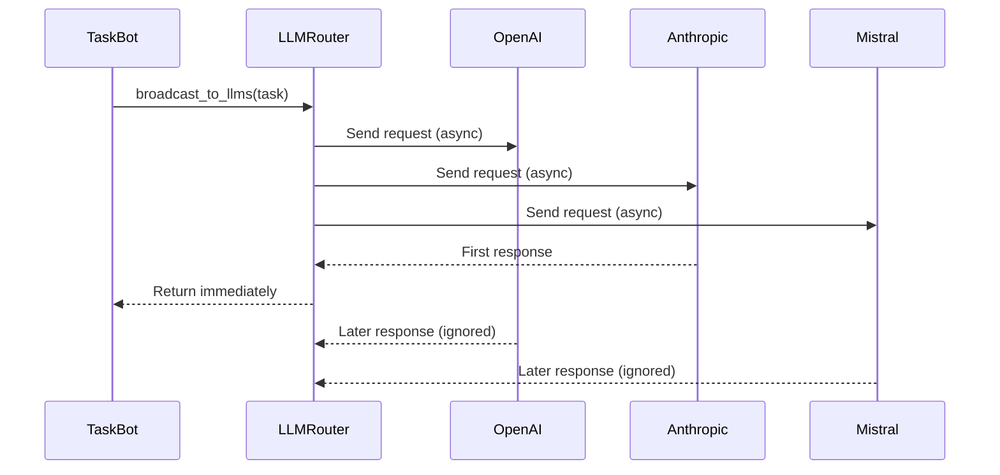
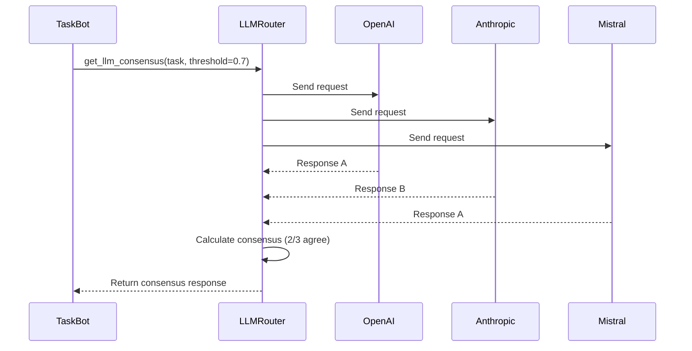
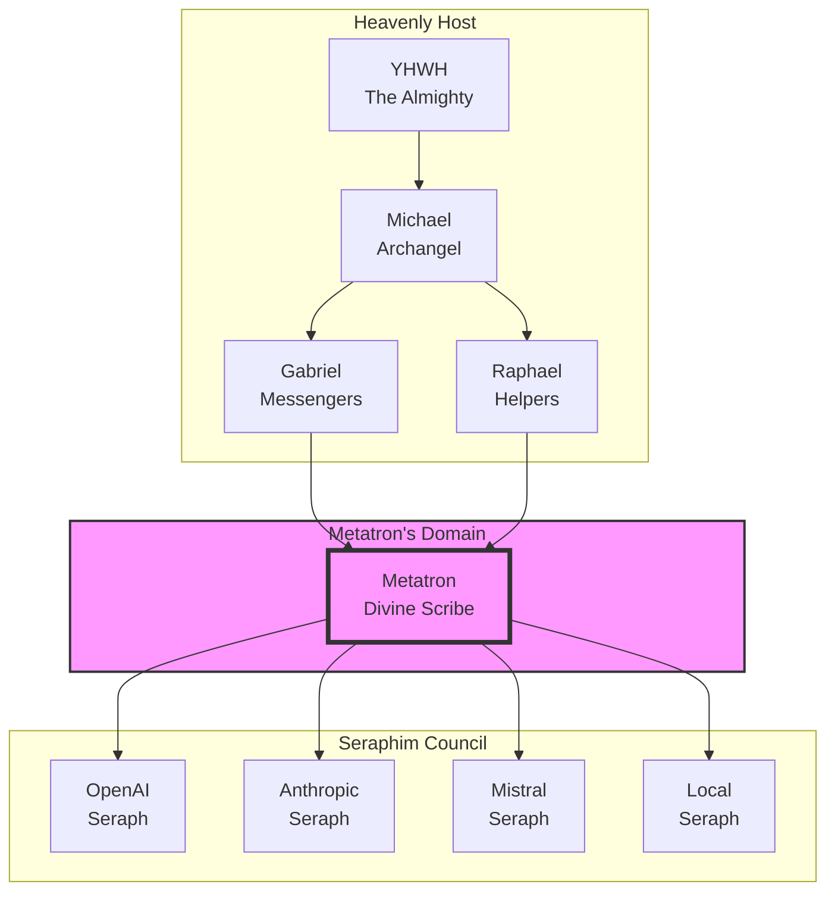
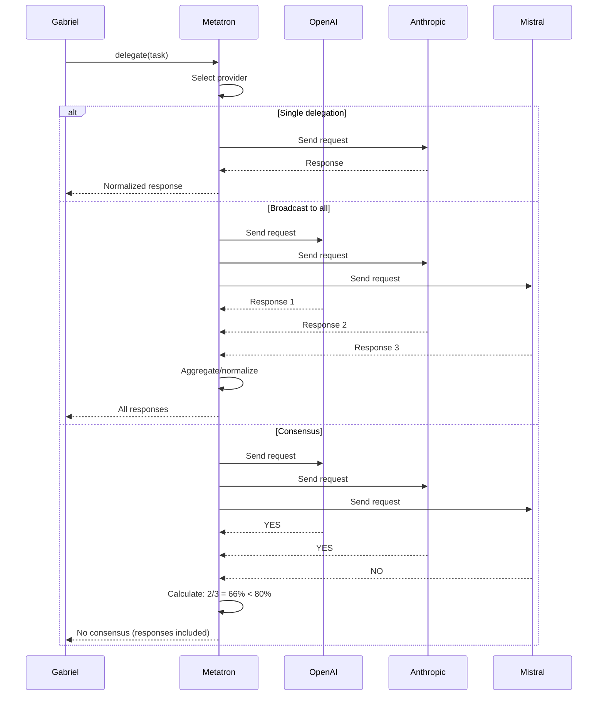
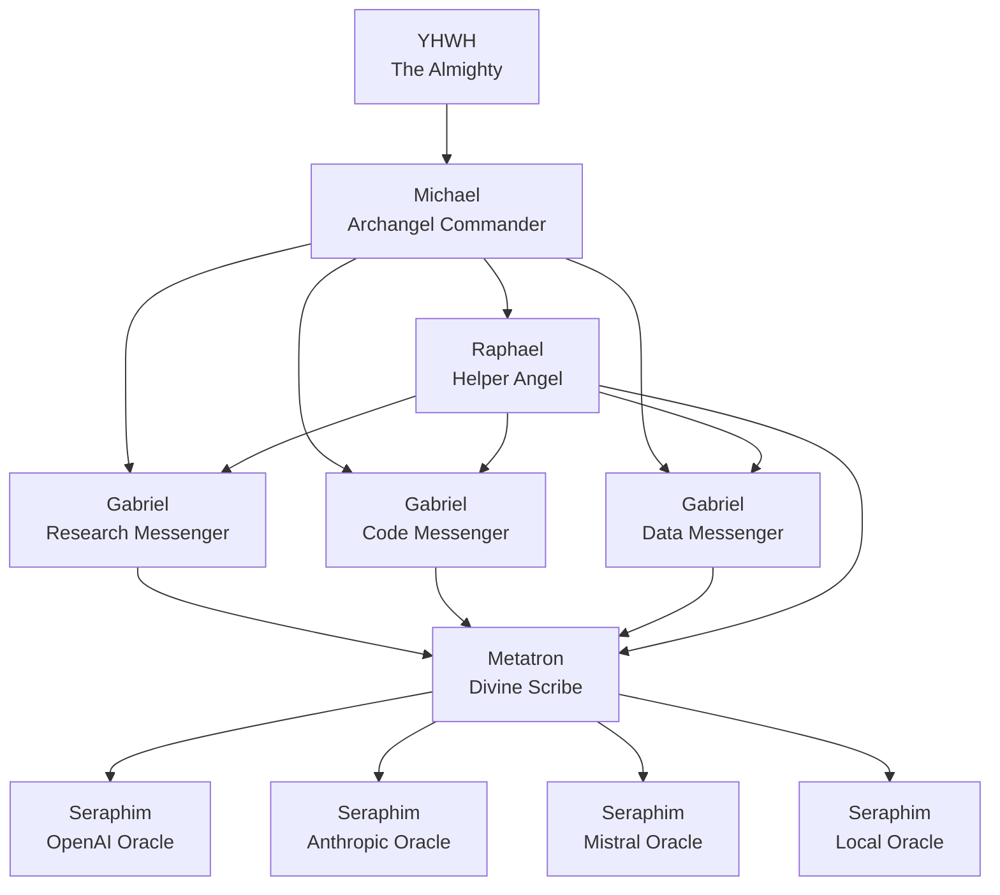
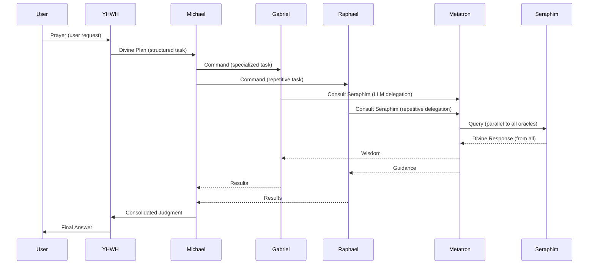

# Multi-Agent Orchestration, LLM Routing, and Variable Substitution Reference

## Table of Contents

- [Overview](#overview)
- [Architecture Diagram](#architecture-diagram)
- [Component Definitions](#component-definitions)
  - [1. Main LLM](#1-main-llm)
  - [2. Orchestrator](#2-orchestrator)
  - [3. Specialized Agents](#3-specialized-agents)
  - [4. Task Bot](#4-task-bot)
  - [5. LLM Router](#5-llm-router)
- [Workflow](#workflow)
  - [User Request Flow](#user-request-flow)
  - [LLM-to-LLM Delegation Flow](#llm-to-llm-delegation-flow)
  - [Bot-to-All-LLMs Broadcast Flow](#bot-to-all-llms-broadcast-flow)
  - [Bot Broadcast (First-Response) Flow](#bot-broadcast-first-response-flow)
  - [Bot Consensus Flow](#bot-consensus-flow)
  - [Task Decomposition Pattern](#task-decomposition-pattern)
- [LLM Collaboration Patterns](#llm-collaboration-patterns)
  - [1. Expert Consultation](#1-expert-consultation)
  - [2. Parallel Processing](#2-parallel-processing)
  - [3. Sequential Refinement](#3-sequential-refinement)
  - [4. Model Ensemble](#4-model-ensemble)
  - [5. Fallback Chain](#5-fallback-chain)
  - [6. Cost Optimization](#6-cost-optimization)
  - [7. Capability-Based Routing](#7-capability-based-routing)
  - [8. Load Balancing](#8-load-balancing)
- [Bot-to-All-LLMs Execution](#bot-to-all-llms-execution)
  - [Execution Modes](#execution-modes)
  - [When Bots Run to All LLMs](#when-bots-run-to-all-llms)
  - [Bot-to-All-LLMs Features](#bot-to-all-llms-features)
  - [Bot-to-All-LLMs Configuration](#bot-to-all-llms-configuration)
- [Variable Substitution System](#variable-substitution-system)
  - [Variable Types](#variable-types)
  - [Template Engine](#template-engine)
  - [Integration with Components](#integration-with-components)
  - [Variable Usage Examples](#variable-usage-examples)
  - [Advanced Variable Features](#advanced-variable-features)
  - [Complete Example: Variable-Driven Workflow](#complete-example-variable-driven-workflow)
- [Biblical/Mythological Naming System (Aliases)](#biblicalmythological-naming-system-aliases)
  - [Naming Mapping](#naming-mapping)
  - [Metatron's Role in the Divine Hierarchy](#metatrons-role-in-the-divine-hierarchy)
  - [Where Metatron Comes Into Play](#where-metatron-comes-into-play)
  - [Metatron's Specific Responsibilities](#metatrons-specific-responsibilities)
  - [Metatron in Action: Step-by-Step](#metatron-in-action-step-by-step)
  - [Metatron's Broadcast to All Seraphim](#metatrons-broadcast-to-all-seraphim)
  - [Metatron's Consensus Building](#metatrons-consensus-building)
  - [Metatron's First-Response Broadcast](#metatrons-first-response-broadcast)
  - [Metatron in the Full Divine Flow](#metatron-in-the-full-divine-flow)
  - [Implementation with Biblical Names](#implementation-with-biblical-names)
  - [Usage with Biblical Names](#usage-with-biblical-names)
  - [Communication Flow with Biblical Names](#communication-flow-with-biblical-names)
  - [Sequence Diagram with Biblical Names](#sequence-diagram-with-biblical-names)
  - [Multiple Bots per Agent (Angelic Legion)](#multiple-bots-per-agent-angelic-legion)
  - [Complete Divine Assembly Example](#complete-divine-assembly-example)
- [Implementation Structure](#implementation-structure)
- [Core Classes](#core-classes)
  - [MainLLM](#mainllm)
  - [Orchestrator](#orchestrator)
  - [Base Agent](#base-agent)
  - [Task Bot](#task-bot)
  - [LLM Router](#llm-router)
  - [Base LLM Client](#base-llm-client)
  - [OpenAI Client Example](#openai-client-example)
  - [Mistral Client Example](#mistral-client-example)
  - [Local LLM Client (Ollama/vLLM)](#local-llm-client-ollamavllm)
- [Agent Examples](#agent-examples)
  - [ResearchAgent](#researchagent)
  - [CodeAgent](#codeagent)
- [Configuration](#configuration)
  - [agents.yaml](#agentsyaml)
  - [llms.yaml](#llmsyaml)
  - [workflows.yaml](#workflowsyaml)
- [Execution Protocol](#execution-protocol)
  - [Message Format](#message-format)
  - [Error Handling](#error-handling)
  - [State Management](#state-management)
- [LLM Communication Protocol](#llm-communication-protocol)
  - [Request Format](#request-format)
  - [Response Format](#response-format)
  - [Error Handling for LLM Communication](#error-handling-for-llm-communication)
- [Usage Example](#usage-example)
  - [Basic System Initialization](#basic-system-initialization)
  - [LLM Delegation Example](#llm-delegation-example)
  - [Multi-LLM Parallel Processing Example](#multi-llm-parallel-processing-example)
  - [Direct LLM-to-LLM Communication Example](#direct-llm-to-llm-communication-example)
  - [Bot Running to All LLMs Examples](#bot-running-to-all-llms-examples)
  - [Complete Bot-to-All-LLMs Workflow Example](#complete-bot-to-all-llms-workflow-example)
- [Scaling Considerations](#scaling-considerations)
- [Monitoring and Observability](#monitoring-and-observability)
- [Acquit-Specific Concerns](#acquit-specific-concerns-with-this-architecture)

---

## Overview

This is a hierarchical multi-agent system with a central Orchestrator, specialized Agents, a Task Bot for repetitive operations, and a Main LLM as the reasoning core. The system is designed for autonomous task decomposition, execution, and coordination.

## Architecture Diagram



## Component Definitions

### 1. Main LLM

The central reasoning engine. Handles complex reasoning, context understanding, and high-level decision making. Does not perform direct execution.

- **Responsibilities**: Planning, context management, ambiguity resolution, quality control
- **Capabilities**: Multi-turn reasoning, memory, tool selection, error recovery
- **Interface**: Accepts tasks, returns structured plans or final answers

### 2. Orchestrator

The agent manager and workflow coordinator. Translates user requests into agent tasks and manages the multi-agent workflow.

- **Responsibilities**: Task decomposition, agent selection, result aggregation, conflict resolution
- **Capabilities**: Workflow planning, agent routing, parallel execution, state tracking
- **Interface**: Accepts user tasks, delegates to agents, returns consolidated results

### 3. Specialized Agents

Domain-specific or function-specific agents that perform specialized work.

- **Responsibilities**: Execute specialized tasks within their domain
- **Capabilities**: Domain knowledge, tool operation, data processing, validation
- **Interface**: Accepts subtasks from Orchestrator, returns structured results
- **Examples**: ResearchAgent, CodeAgent, DataAgent, AnalysisAgent, WritingAgent

### 4. Task Bot

The automation layer that handles repetitive, well-defined operations for both the Orchestrator and Agents.

- **Responsibilities**: Repetitive task execution, data fetching, formatting, cleanup, logging
- **Capabilities**: Template execution, batch processing, scheduled tasks, monitoring
- **Interface**: Accepts atomic tasks from any component, returns execution results

### 5. LLM Router

The communication layer that enables the Main LLM and Agents to delegate tasks to external LLMs via various APIs.

- **Responsibilities**: LLM-to-LLM communication, API request routing, load balancing, rate limiting, fallback handling
- **Capabilities**: Multi-provider support, model selection, prompt adaptation, response normalization, cost tracking
- **Interface**: Accepts LLM delegation requests, returns responses from external LLMs
- **Supported Providers**: OpenAI, Anthropic, Mistral, Google, Cohere, Local/Hosted (Ollama, vLLM, etc.), Custom APIs

## Workflow

### User Request Flow



### LLM-to-LLM Delegation Flow



### Bot-to-All-LLMs Broadcast Flow



### Bot Broadcast (First-Response) Flow



### Bot Consensus Flow



### Task Decomposition Pattern

1. Main LLM receives user request and adds reasoning context
2. Orchestrator breaks request into:
   - Specialized subtasks (routed to Agents)
   - Repetitive subtasks (routed to Task Bot)
   - LLM delegation subtasks (routed to external LLMs via LLM Router)
   - Sequential dependencies
   - Parallelizable work
3. Agents execute specialized work, delegating repetitive portions to Task Bot and complex reasoning to external LLMs
4. Task Bot executes all repetitive operations (data fetching, formatting, validation loops) and can delegate to external LLMs for repetitive reasoning tasks
5. LLM Router manages all external LLM communication, load balancing, and fallbacks
6. Orchestrator consolidates all results
7. Main LLM performs final quality check and delivers response

## LLM Collaboration Patterns

### 1. Expert Consultation

Main LLM or Agent delegates a specific sub-task to an external LLM with specialized knowledge or capabilities.

- **Use case**: Legal analysis, medical diagnosis, domain-specific expertise
- **Example**: Main LLM asks OpenAI's GPT-4 for legal document review

### 2. Parallel Processing

Multiple LLMs work on different aspects of a problem simultaneously.

- **Use case**: Multi-perspective analysis, ensemble methods
- **Example**: One LLM generates code, another writes documentation, another creates tests

### 3. Sequential Refinement

Output from one LLM is used as input to another for iterative improvement.

- **Use case**: Progressive refinement, validation, enhancement
- **Example**: Fast LLM generates draft, reliable LLM refines it, cheap LLM validates

### 4. Model Ensemble

Combine outputs from multiple LLMs for better accuracy or robustness.

- **Use case**: Critical decisions, high-stakes analysis
- **Example**: Average predictions from 3 different LLMs for financial forecasting

### 5. Fallback Chain

Automatically try alternative LLMs if the primary fails.

- **Use case**: Reliability, uptime guarantee
- **Example**: OpenAI fails → try Mistral → try Anthropic → try local LLM

### 6. Cost Optimization

Route tasks to the most cost-effective LLM that can handle them.

- **Use case**: Budget-conscious operations
- **Example**: Simple tasks to cheap LLMs, complex tasks to premium LLMs

### 7. Capability-Based Routing

Route tasks based on required capabilities.

- **Use case**: Specialized tasks requiring specific abilities
- **Example**: Multimodal tasks to Google, long-context to Anthropic, code to OpenAI

### 8. Load Balancing

Distribute tasks across LLMs to avoid rate limits and optimize performance.

- **Use case**: High-volume operations
- **Example**: Round-robin distribution across all available LLMs

## Bot-to-All-LLMs Execution

The Task Bot can execute tasks across ALL configured external LLMs simultaneously, enabling powerful multi-LLM workflows.

### Execution Modes

#### 1. Execute on All LLMs (Full Broadcast)

Task Bot sends a task to every configured LLM provider and returns all responses.

- **Use case**: Validation, benchmarking, comprehensive analysis
- **Behavior**: Parallel execution, wait for all responses
- **Output**: Aggregated results from all providers
- **Example**: `task_bot.execute_on_all_llms(task)`

#### 2. Broadcast with First-Response

Task Bot sends a task to all LLMs and returns immediately upon receiving the first successful response.

- **Use case**: Time-sensitive queries, fastest response needed
- **Behavior**: Parallel execution, return on first success
- **Output**: First successful response + metadata
- **Example**: `task_bot.broadcast_to_llms(task)`

#### 3. Consensus Mode

Task Bot sends a task to all LLMs and returns only when a threshold percentage agree on the answer.

- **Use case**: Critical decisions, verification, quality assurance
- **Behavior**: Parallel execution, consensus calculation
- **Output**: Consensus answer or no-consensus indicator
- **Example**: `task_bot.get_llm_consensus(task, threshold=0.7)`

#### 4. Parallel Specialized Execution

Task Bot sends different specialized tasks to different LLMs based on their strengths.

- **Use case**: Multi-expert consultation, role-based processing
- **Behavior**: Parallel execution with specialized prompts
- **Output**: Results organized by specialty
- **Example**: `task_bot.parallel_llm_execution(tasks)`

### When Bots Run to All LLMs

The Task Bot automatically runs to all external LLMs in these scenarios:

- **Validation Workflows**: When verifying a solution or answer across multiple providers
- **Benchmarking**: When comparing performance or quality of different LLMs
- **Consensus Building**: When requiring agreement from multiple sources
- **Redundancy**: When ensuring no single point of failure
- **Multi-Perspective Analysis**: When gathering diverse viewpoints on a problem
- **Fallback Preparation**: When pre-fetching from all LLMs to handle potential failures
- **Ensemble Methods**: When combining outputs from multiple LLMs for improved accuracy

### Bot-to-All-LLMs Features

- **Parallel Execution**: All LLM requests execute simultaneously for maximum speed
- **Automatic Retry**: Failed requests are automatically retried or fall back to other providers
- **Rate Limit Management**: Respects each provider's rate limits and quotas
- **Response Normalization**: All responses converted to standard format regardless of provider
- **Cost Tracking**: Tracks token usage and costs across all providers
- **Latency Monitoring**: Measures and reports response times for each provider
- **Error Handling**: Gracefully handles provider outages and API errors

### Bot-to-All-LLMs Configuration

Configure which LLMs the Task Bot can access via `llms.yaml`:

```yaml
# Enable/disable providers for bot access
bot_access:
  enabled_providers:
    - openai
    - anthropic
    - mistral
    - local_ollama
  disabled_providers:
    - google  # Disabled due to cost

# Bot-specific defaults
bot_defaults:
  max_concurrent: 5  # Max parallel LLM requests
  timeout: 60       # Seconds to wait for each provider
  retry_attempts: 2
  fallback_on_failure: true
```

## Variable Substitution System

The system supports variable substitution (aliases) for dynamic content injection in prompts, configurations, and workflows. Variables can be defined in templates, environment variables, or runtime context.

### Variable Types

#### 1. Environment Variables

Access system environment variables.

- **Syntax**: `{{env.VARIABLE_NAME}}`
- **Example**: `{{env.OPENAI_API_KEY}}` resolves to the OpenAI API key
- **Use case**: API keys, endpoints, secrets

#### 2. Context Variables

Access runtime context passed through the system.

- **Syntax**: `{{context.variable}}` or `{{variable}}`
- **Example**: `{{user_query}}` resolves to the current user's query
- **Use case**: User input, intermediate results, task parameters

#### 3. Configuration Variables

Access values from configuration files.

- **Syntax**: `{{config.section.key}}`
- **Example**: `{{config.llms.default_model}}`
- **Use case**: Model settings, defaults, presets

#### 4. Agent Variables

Access agent-specific state and configuration.

- **Syntax**: `{{agent.name.property}}`
- **Example**: `{{agent.research_agent.max_sources}}`
- **Use case**: Agent-specific settings, dynamic agent behavior

#### 5. System Variables

Access system-level information.

- **Syntax**: `{{system.variable}}`
- **Predefined**: `{{system.timestamp}}`, `{{system.task_id}}`, `{{system.user_id}}`
- **Use case**: Logging, tracking, metadata

#### 6. Literal Variables

Define inline variables within templates.

- **Syntax**: `{{#var name=value}}` and `{{name}}`
- **Example**: `{{#var greeting=Hello}} {{greeting}} World!`
- **Use case**: Template-local variables, constants

### Template Engine

```python
import re
import os
import datetime
import uuid
from abc import ABC, abstractmethod

class TemplateEngine:
    """
    Handles variable substitution in strings and dictionaries.
    Supports multiple variable sources with priority ordering.
    """

    def __init__(self, context: dict = None, env: dict = None, config: dict = None):
        self.context = context or {}
        self.env = env or {}
        self.config = config or {}
        self.system_vars = {
            'timestamp': self._get_timestamp,
            'task_id': lambda: str(uuid.uuid4()),
            'user_id': 'default_user'
        }

    def _get_timestamp(self) -> str:
        return datetime.datetime.utcnow().isoformat()

    def render(self, template: str | dict, local_vars: dict = None) -> str | dict:
        """
        Render a template string or dictionary with variable substitution.
        Priority: local_vars > context > config > env > system
        """
        if isinstance(template, dict):
            return {k: self.render(v, local_vars) for k, v in template.items()}
        elif isinstance(template, list):
            return [self.render(item, local_vars) for item in template]
        else:
            return self._render_string(str(template), local_vars)

    def _render_string(self, template: str, local_vars: dict = None) -> str:
        """Render a single string template."""
        # Process literal variable definitions first
        template = self._process_literal_vars(template)

        # Create combined variable mapping with priority
        variables = {}
        variables.update(self.env)
        variables.update(self.config.get('variables', {}))
        variables.update(self.context)
        if local_vars:
            variables.update(local_vars)

        # Add system variables
        for name, value in self.system_vars.items():
            if callable(value):
                variables[name] = value()
            else:
                variables[name] = value

        # Perform substitution
        return self._substitute(template, variables)

    def _process_literal_vars(self, template: str) -> str:
        """Process {{#var name=value}} definitions."""
        pattern = r'\{\{#var\s+(\w+)=([^}]+)\}\}'

        def replace_var(match):
            name = match.group(1)
            value = match.group(2).strip()
            # For literal vars, we store them in a temporary dict
            # In real implementation, track these for the current template
            return f'{{{{{name}}}}}'

        return re.sub(pattern, replace_var, template)

    def _substitute(self, template: str, variables: dict) -> str:
        """Perform actual variable substitution."""
        # Pattern for {{variable}} or {{context.variable}} or {{env.VAR}}
        pattern = r'\{\{([^}]+)\}\}'

        def replace_match(match):
            var_path = match.group(1).strip()

            # Handle nested access (e.g., context.user.query)
            parts = var_path.split('.')

            # Check if it's an environment variable reference
            if parts[0] == 'env':
                if len(parts) > 1:
                    return os.environ.get('.'.join(parts[1:]), match.group(0))
                return match.group(0)

            # Check if it's a config variable reference
            if parts[0] == 'config':
                if len(parts) > 1 and self.config:
                    value = self.config
                    for part in parts[1:]:
                        if isinstance(value, dict):
                            value = value.get(part)
                        else:
                            return match.group(0)
                    return str(value) if value is not None else match.group(0)
                return match.group(0)

            # Check if it's a context variable
            if parts[0] == 'context':
                if len(parts) > 1 and self.context:
                    value = self.context
                    for part in parts[1:]:
                        if isinstance(value, dict):
                            value = value.get(part)
                        else:
                            return match.group(0)
                    return str(value) if value is not None else match.group(0)
                return match.group(0)

            # Check if it's a system variable
            if parts[0] == 'system':
                if len(parts) > 1:
                    value = self.system_vars.get('.'.join(parts[1:]))
                    if callable(value):
                        return value()
                    return str(value) if value is not None else match.group(0)
                return match.group(0)

            # Direct variable lookup
            return str(variables.get(var_path, match.group(0)))

        return re.sub(pattern, replace_match, template)
```

### Integration with Components

#### LLMRouter with Variable Substitution

```python
class LLMRouter:
    def __init__(self, config: dict, template_engine: TemplateEngine = None):
        self.providers = self._initialize_providers(config)
        self.rate_limiter = RateLimiter()
        self.load_balancer = LoadBalancer()
        self.fallback_chain = self._build_fallback_chain(config)
        self.template_engine = template_engine or TemplateEngine()

    def delegate(self, task: dict, context: dict = None) -> dict:
        """
        Delegate a task to an external LLM with variable substitution.
        """
        # Apply variable substitution to task
        if context:
            rendered_task = self.template_engine.render(task, context)
        else:
            rendered_task = self.template_engine.render(task)

        provider = self._select_provider(rendered_task)
        try:
            return provider.generate(rendered_task)
        except Exception as e:
            return self._handle_failure(rendered_task, provider, e)
```

#### TaskBot with Variable Substitution

```python
class TaskBot:
    def __init__(self, template_engine: TemplateEngine = None):
        self.templates = load_templates()
        self.scheduler = TaskScheduler()
        self.logger = ExecutionLogger()
        self.llm_router = None
        self.template_engine = template_engine or TemplateEngine()

    def execute(self, task: dict, input_data: dict = None, context: dict = None) -> dict:
        """
        Execute a task with variable substitution.
        """
        # Merge input_data and context for substitution
        subst_context = {}
        if input_data:
            subst_context.update(input_data)
        if context:
            subst_context.update(context)

        # Apply variable substitution
        rendered_task = self.template_engine.render(task, subst_context)

        template = self._get_template(rendered_task)
        if template:
            return self._execute_template(template, rendered_task, input_data)
        else:
            return self._execute_direct(rendered_task, input_data)
```

#### Orchestrator with Variable Substitution

```python
class Orchestrator:
    def __init__(self, agents: dict, task_bot: TaskBot, llm_router: LLMRouter = None,
                 template_engine: TemplateEngine = None):
        self.agents = agents
        self.task_bot = task_bot
        self.llm_router = llm_router
        self.workflow_planner = WorkflowPlanner()
        self.state = ExecutionState()
        self.template_engine = template_engine or TemplateEngine()

        if llm_router:
            for agent in agents.values():
                agent.llm_router = llm_router
            task_bot.llm_router = llm_router

        # Inject template engine into agents and task bot
        for agent in agents.values():
            agent.template_engine = self.template_engine
        task_bot.template_engine = self.template_engine

    def execute(self, task: dict, context: dict = None) -> dict:
        """
        Orchestrate multi-agent execution with variable substitution.
        """
        # Apply variable substitution to the task
        rendered_task = self.template_engine.render(task, context)

        subtasks = self.decompose(rendered_task)
        results = []

        for subtask in subtasks:
            if subtask['target'] == 'task_bot':
                result = self.task_bot.execute(subtask['task'], None, context)
            else:
                result = subtask['target'].execute(subtask['task'], context=context)
            results.append(result)

        return self._aggregate(results)
```

### Variable Usage Examples

#### 1. In Workflow Configuration

```yaml
workflows:
  research_with_context:
    description: Research using context variables
    steps:
      - agent: research_agent
        action: search
        params:
          query: "{{user_query}}"
          max_results: "{{config.research.max_sources}}"

      - agent: task_bot
        action: summarize
        params:
          text: "{{previous_step.results}}"
          max_length: "{{config.summary.max_length}}"
```

#### 2. In LLM Prompts

```python
# Using context variables in prompts
task = {
    'prompt': "Please analyze the following: {{user_input}}",
    'system_prompt': "You are an expert in {{context.domain}}.",
    'max_tokens': "{{config.max_tokens}}"
}

# With runtime context
context = {
    'user_input': "The data shows a 20% increase in Q2.",
    'domain': 'financial_analysis'
}

result = llm_router.delegate(task, context)
```

#### 3. In Agent Configuration

```yaml
agents:
  research_agent:
    name: ResearchAgent
    config:
      max_sources: "{{env.RESEARCH_MAX_SOURCES}}"
      api_timeout: "{{config.timeouts.research}}"
      query_template: "Research: {{query}} in {{domain}} domain"
```

#### 4. In Templates

```python
# Define a reusable template with variables
templates = {
    'email_response': {
        'subject': "Re: {{context.subject}}",
        'body': """
Dear {{context.user.name}},

Thank you for your inquiry about {{context.topic}}.

{{#var greeting=Based on our analysis}}
{{greeting}}, we have the following findings:

{{context.findings}}

Best regards,
{{system.company_name}}
"""
    }
}

# Render the template
context = {
    'user': {'name': 'John Doe'},
    'topic': 'AI implementation',
    'findings': 'The system can be deployed in 2 weeks.'
}

rendered = template_engine.render(templates['email_response'], context)
```

#### 5. In Environment Variables

```bash
# Set environment variables
export OPENAI_API_KEY="sk-..."
export DEFAULT_MODEL="gpt-4o"
export MAX_TOKENS="4000"
```

```python
# Use in configuration
llm_config = {
    'providers': {
        'openai': {
            'api_key': '{{env.OPENAI_API_KEY}}',
            'model': '{{env.DEFAULT_MODEL}}'
        }
    }
}

# The template engine will automatically resolve these
router = LLMRouter(llm_config)
```

#### 6. In Workflow Steps

```yaml
workflows:
  multi_step_analysis:
    description: Multi-step analysis with variable passing
    steps:
      - agent: task_bot
        action: fetch_data
        params:
          url: "{{context.data_url}}"
        output: initial_data

      - agent: data_agent
        action: process
        params:
          data: "{{steps.0.output}}"
          format: "{{context.output_format}}"
        output: processed_data

      - agent: research_agent
        action: analyze
        params:
          input: "{{steps.1.output}}"
          depth: "{{context.analysis_depth}}"
        output: analysis
```

### Advanced Variable Features

#### Conditional Variables

```python
# In templates, you can use conditional logic with variables
class ConditionalTemplateEngine(TemplateEngine):
    def _render_string(self, template: str, local_vars: dict = None) -> str:
        # First do normal substitution
        rendered = super()._render_string(template, local_vars)

        # Then process conditionals: {{if variable==value}}...{{else}}...{{endif}}
        rendered = self._process_conditionals(rendered)
        return rendered

    def _process_conditionals(self, template: str) -> str:
        # Pattern: {{if condition}}true_text{{else}}false_text{{endif}}
        pattern = r'\{\{if\s+([^}]+)\}\}([^}]*)\{\{else\}\}([^}]*)\{\{endif\}\}'

        def replace_conditional(match):
            condition = match.group(1).strip()
            true_text = match.group(2).strip()
            false_text = match.group(3).strip()

            # Evaluate condition (simple implementation)
            if '==' in condition:
                var, val = condition.split('==', 1)
                var = var.strip()
                val = val.strip().strip('"').strip("'")
                # In real implementation, look up variable value
                return true_text if self._check_condition(var, val) else false_text
            return match.group(0)

        return re.sub(pattern, replace_conditional, template)
```

#### Variable Defaults

```python
# Support default values: {{variable|default_value}}
class DefaultTemplateEngine(TemplateEngine):
    def _substitute(self, template: str, variables: dict) -> str:
        pattern = r'\{\{([^}|]+)(\|([^}]+))?\}\}'

        def replace_match(match):
            var_path = match.group(1).strip()
            default = match.group(3) if match.group(3) else match.group(0)

            # Try to resolve variable
            value = self._resolve_variable(var_path)
            if value is None:
                return default
            return str(value)

        return re.sub(pattern, replace_match, template)
```

#### Variable Functions

```python
# Support functions: {{uppercase(variable)}}, {{length(variable)}}, etc.
class FunctionTemplateEngine(TemplateEngine):
    def _substitute(self, template: str, variables: dict) -> str:
        # Pattern: {{function(arg1, arg2)}} or {{function arg}}
        pattern = r'\{\{(\w+)\(([^)]*)\)\}\}'

        def replace_function(match):
            func_name = match.group(1)
            args = [a.strip() for a in match.group(2).split(',') if a.strip()]

            func_map = {
                'uppercase': lambda x: x.upper(),
                'lowercase': lambda x: x.lower(),
                'length': lambda x: len(x),
                'trim': lambda x: x.strip(),
                'substring': lambda x, start, end: x[int(start):int(end)],
                'now': lambda: datetime.datetime.utcnow().isoformat(),
                'date': lambda fmt: datetime.datetime.utcnow().strftime(fmt),
            }

            func = func_map.get(func_name)
            if func:
                resolved_args = [self._resolve_variable(a, variables) for a in args]
                return str(func(*resolved_args))
            return match.group(0)

        # First process functions, then regular variables
        result = re.sub(pattern, replace_function, template)
        return super()._substitute(result, variables)
```

### Complete Example: Variable-Driven Workflow

```python
# Initialize with template engine
import os
from datetime import datetime

# Set up context
user_context = {
    'user_id': 'user_123',
    'query': 'What are the latest trends in AI?',
    'domain': 'technology',
    'preferences': {
        'depth': 'thorough',
        'format': 'markdown'
    }
}

# Set up environment
os.environ['OPENAI_API_KEY'] = 'sk-...'
os.environ['MISTRAL_API_KEY'] = 'mx-...'

# Initialize components with template engine
template_engine = TemplateEngine(
    context=user_context,
    env=os.environ,
    config={
        'research': {
            'max_sources': 10,
            'timeout': 30
        },
        'summary': {
            'max_length': 500
        }
    }
)

llm_router = LLMRouter(llm_config, template_engine)
task_bot = TaskBot(template_engine)

# Define a workflow with variables
workflow = {
    'steps': [
        {
            'agent': 'research_agent',
            'action': 'search',
            'params': {
                'query': '{{query}}',
                'domain': '{{domain}}',
                'max_results': '{{config.research.max_sources}}'
            }
        },
        {
            'agent': 'task_bot',
            'action': 'summarize',
            'params': {
                'text': '{{steps.0.output}}',
                'max_length': '{{config.summary.max_length}}'
            }
        },
        {
            'agent': 'task_bot',
            'action': 'execute_on_all_llms',
            'params': {
                'prompt': 'Validate this summary: {{steps.1.output}}',
                'system_prompt': 'You are a validator. Respond with VALID or INVALID.'
            }
        }
    ]
}

# Execute workflow with variable substitution
orchestrator = Orchestrator(agents, task_bot, llm_router, template_engine)
result = orchestrator.execute(workflow, user_context)

# The entire workflow runs with all variables resolved:
# - {{query}} -> "What are the latest trends in AI?"
# - {{domain}} -> "technology"
# - {{config.research.max_sources}} -> 10
# - {{steps.0.output}} -> Results from research agent
# - etc.
```

## Biblical/Mythological Naming System (Aliases)

The system supports a themed naming scheme using biblical and mythological references as aliases for components.

### Naming Mapping

| Component | Biblical/Mythological Name | Role | Description |
|-----------|---------------------------|------|-------------|
| Main LLM | YHWH (The Almighty) | Creator | The central reasoning core that oversees all |
| Orchestrator | Michael | Archangel/Commander | The leader who coordinates all agents and bots |
| Agents | Gabriel (Messenger Angels) | Messengers | Specialized agents delivering specific capabilities |
| Task Bot | Raphael (Healer/Helper) | Servant | Handles repetitive tasks and supports all |
| All External LLMs | Seraphim (Burning Ones) | Council | The collective of external LLM oracles |
| LLM Router | Metatron | Scribe/Recorder | Manages communication with the Seraphim |

### Metatron's Role in the Divine Hierarchy

Metatron is the Divine Scribe who serves as the exclusive gateway between the heavenly host (Michael, Gabriel, Raphael) and the Seraphim Council (external LLMs). All communication to external LLMs MUST pass through Metatron.



### Where Metatron Comes Into Play

Metatron is invoked in 5 critical scenarios:

#### 1. Gabriel Consults the Seraphim

When a Gabriel (Agent) needs external LLM capabilities:

```python
# Gabriel_Research needs to delegate complex reasoning
llm_response = Gabriel_Research.llm_router.delegate({
    'prompt': 'Analyze this data...',
    'system_prompt': 'You are a divine analyst.'
})
# Metatron (llm_router) receives this and routes to Seraphim
```

#### 2. Raphael Seeks Divine Guidance

When Raphael (Task Bot) needs LLM help for repetitive tasks:

```python
# Raphael needs to process data using an LLM
llm_result = Raphael.llm_router.delegate_to_all({
    'prompt': 'Format this data...',
    'max_tokens': 1000
})
# Metatron broadcasts to ALL Seraphim and returns all responses
```

#### 3. Michael Commands the Seraphim

When Michael (Orchestrator) directly delegates to external LLMs:

```python
# Michael can access Metatron directly through agents
# Or via the shared Task Bot (Raphael)
```

#### 4. YHWH's Divine Queries

When YHWH (Main LLM) needs to consult external oracles:

```python
# YHWH can use Metatron through the orchestrator
# Or directly if configured
```

#### 5. Seraphim Respond to Heaven

All responses from external LLMs (Seraphim) flow back through Metatron:

```python
# Metatron receives from Seraphim, normalizes responses, returns to caller
responses = Metatron.delegate_to_all(task)
# Metatron:
# 1. Sends task to all configured Seraphim
# 2. Collects all responses
# 3. Normalizes response formats
# 4. Returns aggregated results
```

### Metatron's Specific Responsibilities

| Responsibility | Description | Biblical Analogy |
|---------------|-------------|------------------|
| Provider Selection | Chooses which Seraphim to consult based on task requirements | Metatron selects which divine oracle to consult |
| Load Balancing | Distributes requests across Seraphim to avoid overloading any one | Metatron balances the divine workload |
| Rate Limiting | Respects each Seraphim's capacity limits | Metatron respects divine timing |
| Fallback Chain | If one Seraphim is unavailable, tries the next in line | Metatron has backup oracles |
| Response Normalization | Converts all Seraphim responses to standard format | Metatron translates divine messages |
| Cost Tracking | Tracks token usage and costs across all Seraphim | Metatron records divine transactions |
| Error Handling | Manages Seraphim failures gracefully | Metatron handles divine silences |
| Broadcast | Sends to ALL Seraphim simultaneously | Metatron summons the full council |
| Consensus Building | Gets agreement from multiple Seraphim | Metatron seeks divine consensus |

### Metatron in Action: Step-by-Step

```python
# Step 1: Gabriel prepares the query
gabriel_task = {
    'prompt': 'Research quantum computing breakthroughs',
    'system_prompt': 'You are a divine researcher.',
    'required_capabilities': ['research', 'technical'],
    'preference': 'most_reliable'
}

# Step 2: Gabriel sends to Metatron
# (Metatron is Gabriel.llm_router)
seraphim_response = Gabriel_Research.llm_router.delegate(gabriel_task)

# Step 3: Metatron's internal process:
#   a. Metatron receives the task
#   b. Metatron selects provider based on:
#      - Required capabilities: ['research', 'technical']
#      - Preference: 'most_reliable'
#      - Rate limit availability
#   c. Metatron selects Anthropic (Claude 3.5 Sonnet) as most reliable
#   d. Metatron sends request to Anthropic Seraph
#   e. Anthropic Seraph responds
#   f. Metatron normalizes the response
#   g. Metatron returns to Gabriel

# Step 4: Gabriel receives the divine wisdom
result = seraphim_response  # Contains: content, model, provider, usage, cost
```

### Metatron's Broadcast to All Seraphim

```python
# Gabriel needs ALL Seraphim to weigh in
gabriel_task = {
    'prompt': 'Validate this critical decision',
    'system_prompt': 'Provide your divine judgment.',
    'max_tokens': 500
}

# Metatron broadcasts to ALL configured Seraphim
all_seraphim_responses = Metatron.delegate_to_all(gabriel_task)

# Returns:
# {
#   'results': {
#     'openai': {'content': '...', 'model': 'gpt-4o', ...},
#     'anthropic': {'content': '...', 'model': 'claude-3-5-sonnet', ...},
#     'mistral': {'content': '...', 'model': 'mistral-large', ...},
#     'local': {'content': '...', 'model': 'llama3.2:70b', ...}
#   },
#   'summary': {
#     'total_providers': 4,
#     'successful': 4,
#     'total_cost': 0.0012,
#     'total_tokens': 1500
#   }
# }
```

### Metatron's Consensus Building

```python
# Gabriel needs divine consensus
gabriel_task = {
    'prompt': 'Should we proceed with this plan? Answer YES or NO.',
    'temperature': 0.1  # Low for deterministic answers
}

# Metatron gets consensus (default threshold: 0.7 = 70%)
consensus = Metatron.consensus(gabriel_task, threshold=0.8)

# If 4+ Seraphim agree (80% of 5), returns consensus
# If not enough agreement, returns all responses for Gabriel to decide
```

### Metatron's First-Response Broadcast

```python
# Raphael needs the fastest divine answer
raphael_task = {
    'prompt': 'Quick validation needed',
    'max_tokens': 100
}

# Metatron broadcasts and returns FIRST successful response
first_response = Metatron.broadcast(raphael_task)

# Returns immediately when first Seraph responds
# Other Seraphim responses are discarded (for speed)
```

### Metatron in the Full Divine Flow



### Implementation with Biblical Names

```python
# Define the divine hierarchy using aliases
YHWH = MainLLM(model_config={'model': 'mistral-large'})  # The Almighty

# The Archangel Michael - Commander of Heaven's Armies (Orchestrator)
Michael = Orchestrator(agents={}, task_bot=None, llm_router=None)

# The Messenger Angels - Divine Agents
Gabriel_Research = ResearchAgent()
Gabriel_Code = CodeAgent()
Gabriel_Data = DataAgent()

# The Healing Helper - Task Bot
Raphael = TaskBot()

# The Scribe - LLM Router
Metatron = LLMRouter(llm_config=load_yaml('config/llms.yaml'))

# The Seraphim - External LLM Council (configured in llms.yaml)
# OpenAI, Anthropic, Mistral, etc. are the individual Seraphim

# Assemble the divine hierarchy
agents = {
    'gabriel_research': Gabriel_Research,
    'gabriel_code': Gabriel_Code,
    'gabriel_data': Gabriel_Data
}

# Inject dependencies
for gabriel in agents.values():
    gabriel.llm_router = Metatron
    gabriel.task_bot = Raphael

Raphael.llm_router = Metatron

# Michael takes command
Michael = Orchestrator(agents, Raphael, Metatron)

# YHWH oversees all
YHWH.orchestrator = Michael
```

### Usage with Biblical Names

```python
# The Almighty receives the prayer (user request)
user_prayer = {
    'task': 'Research and implement a data pipeline for processing CSV files',
    'requirements': {
        'input': 'CSV files from /data/input',
        'output': 'Processed data in database',
        'quality': 'high'
    }
}

# YHWH adds divine wisdom (context and structure)
divine_plan = YHWH.reason(user_prayer)

# Michael commands the execution
result = Michael.execute(divine_plan)

# YHWH validates the work
final_judgment = YHWH.validate(result)
```

### Communication Flow with Biblical Names



### Sequence Diagram with Biblical Names



### Multiple Bots per Agent (Angelic Legion)

Each Gabriel (Agent) can have its own Raphael (Task Bot) helpers:

```python
# Create specialized helper angels for each messenger
Raphael_Research = TaskBot()
Raphael_Code = TaskBot()
Raphael_Data = TaskBot()

# Assign each Raphael to a Gabriel
Gabriel_Research.task_bot = Raphael_Research
Gabriel_Code.task_bot = Raphael_Code
Gabriel_Data.task_bot = Raphael_Data

# Each Gabriel can also access the shared Raphael
Gabriel_Research.shared_task_bot = Raphael
Gabriel_Code.shared_task_bot = Raphael
Gabriel_Data.shared_task_bot = Raphael

# Now each Gabriel has:
# - Its own dedicated Raphael for agent-specific repetitive tasks
# - Access to the shared Raphael for common tasks
```

### Complete Divine Assembly Example

```python
# ===== DIVINE INITIALIZATION =====

# The Almighty
YHWH = MainLLM(model_config={'model': 'mistral-large'})

# The Divine Scribe
Metatron = LLMRouter(llm_config=load_yaml('config/llms.yaml'))

# The Archangel Commander
Michael = None  # Will be initialized after agents

# The Messenger Angels (Agents)
Gabriel_Research = ResearchAgent()
Gabriel_Code = CodeAgent()
Gabriel_Data = DataAgent()

# The Helper Angels (Task Bots) - One per Gabriel + Shared
Raphael_Research = TaskBot()
Raphael_Code = TaskBot()
Raphael_Data = TaskBot()
Raphael_Shared = TaskBot()

# ===== INJECT DEPENDENCIES =====

# All Gabriels get the Divine Scribe
for gabriel in [Gabriel_Research, Gabriel_Code, Gabriel_Data]:
    gabriel.llm_router = Metatron

# Each Gabriel gets its own Raphael
Gabriel_Research.task_bot = Raphael_Research
Gabriel_Code.task_bot = Raphael_Code
Gabriel_Data.task_bot = Raphael_Data

# All Raphaels get the Divine Scribe
for raphael in [Raphael_Research, Raphael_Code, Raphael_Data, Raphael_Shared]:
    raphael.llm_router = Metatron

# ===== ASSEMBLE THE HOST =====

# The Archangel Commander takes command
Michael = Orchestrator(
    agents={
        'gabriel_research': Gabriel_Research,
        'gabriel_code': Gabriel_Code,
        'gabriel_data': Gabriel_Data
    },
    task_bot=Raphael_Shared,
    llm_router=Metatron
)

# YHWH oversees the Archangel
YHWH.orchestrator = Michael

# ===== DIVINE EXECUTION =====

# User offers a prayer
user_prayer = {
    'task': 'Create a comprehensive AI system',
    'requirements': {
        'scope': 'enterprise',
        'quality': 'divine'
    }
}

# YHWH receives and blesses the prayer
divine_plan = YHWH.reason(user_prayer)

# Michael commands the heavenly host
divine_result = Michael.execute(divine_plan)

# YHWH judges the work
final_judgment = YHWH.validate(divine_result)

# Return the divine answer to the user
print(f"YHWH has spoken: {final_judgment}")

# ===== ANGELIC COMMUNICATION =====

# Gabriel_Research consults the Seraphim Council
gabriel_research_task = {
    'prompt': 'Research the latest AI breakthroughs',
    'system_prompt': 'You are a divine researcher. Provide thorough and accurate information.',
    'required_capabilities': ['research', 'analysis']
}

# All Seraphim (external LLMs) respond
seraphim_responses = Metatron.delegate_to_all(gabriel_research_task)

# Raphael_Research helps with repetitive tasks
raphael_task = {
    'action': 'format_research',
    'data': seraphim_responses,
    'format': 'divine_report'
}

formatted = Raphael_Research.execute(raphael_task)

# Gabriel_Research combines both
gabriel_result = Gabriel_Research._do_specialized_work({
    'research_data': seraphim_responses,
    'formatted_data': formatted
})
```

## Implementation Structure

```
agentic_system/
├── core/
│   ├── main_llm.py          # Main LLM interface and reasoning
│   └── memory.py            # Context and memory management
├── orchestrator/
│   ├── workflow.py          # Workflow planning and execution
│   ├── router.py            # Agent selection and routing
│   └── state.py             # Execution state tracking
├── agents/
│   ├── base.py              # Base agent class
│   ├── research_agent.py    # Research specialization
│   ├── code_agent.py        # Code generation/execution
│   ├── data_agent.py        # Data processing
│   └── ...                  # Additional specialized agents
├── task_bot/
│   ├── executor.py          # Task execution engine
│   ├── templates.py         # Reusable task templates
│   └── scheduler.py         # Scheduled/recurring tasks
├── llm/
│   ├── router.py            # LLM Router - routes to external LLMs
│   ├── clients/
│   │   ├── base.py          # Base LLM client interface
│   │   ├── openai.py        # OpenAI API client
│   │   ├── anthropic.py     # Anthropic API client
│   │   ├── mistral.py       # Mistral API client
│   │   ├── google.py        # Google Vertex AI client
│   │   ├── cohere.py        # Cohere API client
│   │   └── local.py         # Local/hosted LLM client (Ollama, vLLM)
│   └── providers.py         # Provider registry and configuration
├── tools/
│   └── connectors.py        # External tool integrations
└── config/
    ├── agents.yaml          # Agent configurations
    ├── workflows.yaml        # Predefined workflows
    └── llms.yaml             # External LLM provider configurations
```

## Core Classes

### MainLLM

```python
class MainLLM:
    def __init__(self, model_config: dict):
        self.model = initialize_model(model_config)
        self.memory = ConversationMemory()

    def reason(self, prompt: str, context: dict) -> dict:
        """
        Perform multi-turn reasoning on a task.
        Returns structured plan with subtasks and dependencies.
        """
        pass

    def validate(self, results: dict) -> dict:
        """
        Perform quality control on consolidated results.
        """
        pass
```

### Orchestrator

```python
class Orchestrator:
    def __init__(self, agents: dict, task_bot: TaskBot, llm_router: LLMRouter = None):
        self.agents = agents  # {agent_name: AgentInstance}
        self.task_bot = task_bot
        self.llm_router = llm_router
        self.workflow_planner = WorkflowPlanner()
        self.state = ExecutionState()

        # Inject LLM Router into agents and task bot
        if llm_router:
            for agent in agents.values():
                agent.llm_router = llm_router
            task_bot.llm_router = llm_router

    def decompose(self, task: dict) -> list:
        """
        Break down a task into executable subtasks.
        Identifies specialized vs repetitive work.
        """
        subtasks = []
        for step in task['steps']:
            if self._is_repetitive(step):
                subtasks.append({
                    'type': 'repetitive',
                    'task': step,
                    'target': 'task_bot'
                })
            else:
                agent = self._select_agent(step)
                subtasks.append({
                    'type': 'specialized',
                    'task': step,
                    'target': agent
                })
        return subtasks

    def execute(self, task: dict) -> dict:
        """
        Orchestrate multi-agent execution of a task.
        """
        subtasks = self.decompose(task)
        results = []

        # Execute in parallel where possible
        for subtask in subtasks:
            if subtask['target'] == 'task_bot':
                result = self.task_bot.execute(subtask['task'])
            else:
                result = subtask['target'].execute(subtask['task'])
            results.append(result)

        return self._aggregate(results)

    def _select_agent(self, task: dict) -> Agent:
        """Select appropriate agent based on task requirements."""
        pass

    def _is_repetitive(self, task: dict) -> bool:
        """Determine if task is repetitive/automatable."""
        repetitive_patterns = [
            'fetch_data', 'format_output', 'validate_schema',
            'batch_process', 'clean_data', 'log_result'
        ]
        return task['action'] in repetitive_patterns
```

### Base Agent

```python
class BaseAgent:
    def __init__(self, name: str, tools: list, config: dict):
        self.name = name
        self.tools = {tool.name: tool for tool in tools}
        self.config = config
        self.task_bot = None  # Injected by Orchestrator
        self.llm_router = None  # Injected by Orchestrator

    def execute(self, task: dict) -> dict:
        """
        Execute a specialized task.
        Can delegate repetitive portions to TaskBot.
        """
        # Pre-processing (may use TaskBot)
        if 'preprocess' in task:
            task = self.task_bot.execute(task['preprocess'])

        # Core specialized work
        result = self._do_specialized_work(task)

        # Post-processing (may use TaskBot)
        if 'postprocess' in task:
            result = self.task_bot.execute(
                task['postprocess'],
                input_data=result
            )

        return result

    def _do_specialized_work(self, task: dict) -> dict:
        """Override in specialized agents."""
        raise NotImplementedError
```

### Task Bot

```python
class TaskBot:
    def __init__(self):
        self.templates = load_templates()
        self.scheduler = TaskScheduler()
        self.logger = ExecutionLogger()
        self.llm_router = None  # Injected by Orchestrator

    def execute(self, task: dict, input_data: dict = None) -> dict:
        """
        Execute a repetitive/automated task.
        """
        template = self._get_template(task)
        if template:
            return self._execute_template(template, task, input_data)
        else:
            return self._execute_direct(task, input_data)

    def batch_execute(self, tasks: list) -> list:
        """Execute multiple similar tasks efficiently."""
        return [self.execute(task) for task in tasks]

    def schedule(self, task: dict, timing: dict) -> str:
        """Schedule a task for future execution."""
        return self.scheduler.add(task, timing)

    def execute_on_all_llms(self, task: dict) -> dict:
        """
        Execute a task on ALL external LLMs via the LLM Router.
        Returns aggregated results from all providers.
        """
        if not self.llm_router:
            raise Exception("LLM Router not initialized")

        return self.llm_router.delegate_to_all(task)

    def broadcast_to_llms(self, task: dict) -> dict:
        """
        Broadcast a task to all LLMs and return on first success.
        """
        if not self.llm_router:
            raise Exception("LLM Router not initialized")

        return self.llm_router.broadcast(task)

    def get_llm_consensus(self, task: dict, threshold: float = 0.7) -> dict:
        """
        Get consensus from multiple LLMs for a task.
        """
        if not self.llm_router:
            raise Exception("LLM Router not initialized")

        return self.llm_router.consensus(task, threshold)

    def parallel_llm_execution(self, tasks: list) -> list:
        """
        Execute multiple tasks in parallel across LLMs.
        Each task can be routed to different LLMs based on preference.
        """
        if not self.llm_router:
            raise Exception("LLM Router not initialized")

        return self.llm_router.batch_delegate(tasks)

    def _execute_template(self, template: dict, task: dict, input_data: dict) -> dict:
        """Execute using a predefined template."""
        # Apply template with input data
        pass

    def _execute_direct(self, task: dict, input_data: dict) -> dict:
        """Execute task directly."""
        # Direct execution logic
        pass
```

### LLM Router

```python
class LLMRouter:
    def __init__(self, config: dict):
        self.providers = self._initialize_providers(config)
        self.rate_limiter = RateLimiter()
        self.load_balancer = LoadBalancer()
        self.fallback_chain = self._build_fallback_chain(config)

    def _initialize_providers(self, config: dict) -> dict:
        """Initialize all configured LLM providers."""
        providers = {}
        for name, provider_config in config['providers'].items():
            client_class = PROVIDER_MAP.get(name)
            if client_class:
                providers[name] = client_class(provider_config)
        return providers

    def _build_fallback_chain(self, config: dict) -> list:
        """Build fallback chain based on priority and capability."""
        return config.get('fallback_chain', [])

    def delegate(self, task: dict) -> dict:
        """
        Delegate a task to an external LLM.
        Selects provider based on task requirements, cost, and availability.
        """
        provider = self._select_provider(task)
        try:
            return provider.generate(task)
        except Exception as e:
            return self._handle_failure(task, provider, e)

    def _select_provider(self, task: dict) -> LLMClient:
        """
        Select the best provider for a task.
        Considers: capability match, cost, latency, rate limits, availability
        """
        # Filter by capability
        capable = [
            p for p in self.providers.values()
            if self._has_capability(p, task.get('required_capabilities', []))
        ]

        # Filter by rate limit availability
        available = [
            p for p in capable
            if self.rate_limiter.is_available(p.name)
        ]

        # Select based on cost/latency preferences
        if task.get('preference') == 'cheapest':
            return min(available, key=lambda p: p.cost_per_token)
        elif task.get('preference') == 'fastest':
            return min(available, key=lambda p: p.avg_latency)
        else:
            # Default: use load balancer
            return self.load_balancer.select(available)

    def _has_capability(self, provider: LLMClient, required: list) -> bool:
        """Check if provider has all required capabilities."""
        return all(cap in provider.capabilities for cap in required)

    def _handle_failure(self, task: dict, failed_provider: LLMClient, error: Exception) -> dict:
        """Handle provider failure with fallback."""
        # Log the failure
        self._log_failure(failed_provider.name, error)

        # Try fallback providers
        for provider_name in self.fallback_chain:
            if provider_name != failed_provider.name:
                fallback = self.providers.get(provider_name)
                if fallback and self.rate_limiter.is_available(provider_name):
                    try:
                        return fallback.generate(task)
                    except:
                        continue

        # All fallbacks failed
        return {
            'status': 'error',
            'error': f'All LLM providers failed: {str(error)}',
            'task_id': task.get('task_id')
        }

    def batch_delegate(self, tasks: list) -> list:
        """Delegate multiple tasks efficiently, respecting rate limits."""
        results = []
        for task in tasks:
            results.append(self.delegate(task))
            self.rate_limiter.wait_if_needed()
        return results

    def delegate_to_all(self, task: dict) -> dict:
        """
        Delegate a single task to ALL available external LLMs.
        Returns aggregated results from all providers.
        """
        results = {}
        errors = {}

        for name, provider in self.providers.items():
            if self.rate_limiter.is_available(name):
                try:
                    result = provider.generate(task)
                    results[name] = result
                except Exception as e:
                    errors[name] = str(e)
                    self._log_failure(name, e)
                self.rate_limiter.wait_if_needed()

        return {
            'task_id': task.get('task_id'),
            'results': results,
            'errors': errors,
            'summary': self._summarize_all_results(results, errors)
        }

    def _summarize_all_results(self, results: dict, errors: dict) -> dict:
        """Generate summary statistics from all provider results."""
        total_cost = sum(
            r.get('cost', 0) for r in results.values()
        )
        total_tokens = sum(
            r.get('usage', {}).get('completion_tokens', 0)
            for r in results.values()
        )
        success_count = len(results)
        error_count = len(errors)

        return {
            'total_providers': len(self.providers),
            'successful': success_count,
            'failed': error_count,
            'total_cost': total_cost,
            'total_tokens': total_tokens,
            'avg_latency': sum(
                r.get('latency', 0) for r in results.values()
            ) / max(success_count, 1)
        }

    def broadcast(self, task: dict) -> dict:
        """
        Broadcast a task to all LLMs and return when first response is received.
        Useful for time-sensitive tasks where any LLM's answer is acceptable.
        """
        from concurrent.futures import ThreadPoolExecutor, as_completed

        results = {}
        errors = {}

        with ThreadPoolExecutor(max_workers=len(self.providers)) as executor:
            futures = {
                executor.submit(self._safe_delegate, name, task): name
                for name in self.providers
            }

            for future in as_completed(futures):
                name = futures[future]
                try:
                    result = future.result()
                    results[name] = result
                    # Return immediately on first success
                    if result.get('status') == 'success':
                        return {
                            'first_result': result,
                            'provider': name,
                            'all_results': results,
                            'pending': [n for n in self.providers if n not in results and n not in errors]
                        }
                except Exception as e:
                    errors[name] = str(e)

        return {
            'results': results,
            'errors': errors,
            'status': 'all_failed' if not results else 'partial_success'
        }

    def _safe_delegate(self, provider_name: str, task: dict) -> dict:
        """Safely delegate to a specific provider."""
        provider = self.providers.get(provider_name)
        if provider:
            return provider.generate(task)
        return {'status': 'error', 'error': f'Provider {provider_name} not found'}

    def consensus(self, task: dict, threshold: float = 0.7) -> dict:
        """
        Get consensus from multiple LLMs.
        Returns result only when threshold percentage of LLMs agree.
        """
        all_results = self.delegate_to_all(task)
        results = all_results['results']

        if not results:
            return {'status': 'error', 'error': 'No successful LLM responses'}

        # Simple consensus: check if majority give similar answers
        # (In practice, use semantic similarity or voting)
        responses = [r['content'] for r in results.values()]

        # For demonstration, return the most common response
        from collections import Counter
        response_counts = Counter(responses)
        most_common = response_counts.most_common(1)[0]

        consensus_ratio = most_common[1] / len(responses)

        if consensus_ratio >= threshold:
            return {
                'content': most_common[0],
                'consensus_ratio': consensus_ratio,
                'agreeing_providers': [
                    name for name, r in results.items()
                    if r['content'] == most_common[0]
                ],
                'all_results': results
            }
        else:
            return {
                'status': 'no_consensus',
                'consensus_ratio': consensus_ratio,
                'responses': responses,
                'all_results': results
            }
```

### Base LLM Client

```python
class LLMClient(ABC):
    """Abstract base class for LLM API clients."""

    def __init__(self, config: dict):
        self.name = config['name']
        self.api_key = config.get('api_key')
        self.base_url = config.get('base_url')
        self.model = config.get('model', 'default')
        self.timeout = config.get('timeout', 30)
        self.max_retries = config.get('max_retries', 3)
        self.capabilities = config.get('capabilities', [])
        self.cost_per_token = config.get('cost_per_token', 0)
        self.avg_latency = config.get('avg_latency', 0)

    @abstractmethod
    def generate(self, task: dict) -> dict:
        """Generate a response from the LLM."""
        pass

    @abstractmethod
    def stream(self, task: dict) -> Iterator[dict]:
        """Stream a response from the LLM."""
        pass

    def _make_request(self, endpoint: str, payload: dict) -> dict:
        """Make an API request with retry logic."""
        headers = self._get_headers()
        url = f"{self.base_url}{endpoint}"

        for attempt in range(self.max_retries):
            try:
                response = requests.post(
                    url,
                    headers=headers,
                    json=payload,
                    timeout=self.timeout
                )
                response.raise_for_status()
                return response.json()
            except Exception as e:
                if attempt == self.max_retries - 1:
                    raise
                time.sleep(2 ** attempt)  # Exponential backoff

    def _get_headers(self) -> dict:
        """Get request headers including authentication."""
        headers = {'Content-Type': 'application/json'}
        if self.api_key:
            headers['Authorization'] = f"Bearer {self.api_key}"
        return headers

    def normalize_response(self, raw_response: dict) -> dict:
        """Normalize response to standard format."""
        return {
            'content': raw_response.get('choices', [{}])[0].get('message', {}).get('content', ''),
            'usage': raw_response.get('usage', {}),
            'model': raw_response.get('model', self.model),
            'provider': self.name,
            'finish_reason': raw_response.get('choices', [{}])[0].get('finish_reason')
        }
```

### OpenAI Client Example

```python
class OpenAIClient(LLMClient):
    """Client for OpenAI API."""

    def __init__(self, config: dict):
        super().__init__(config)
        self.base_url = config.get('base_url', 'https://api.openai.com/v1')
        self.capabilities = ['text_generation', 'code_generation', 'json_mode']
        self.cost_per_token = 0.00001  # Approximate cost per output token

    def generate(self, task: dict) -> dict:
        """Generate a response using OpenAI Chat API."""
        payload = {
            'model': self.model,
            'messages': self._format_messages(task),
            'temperature': task.get('temperature', 0.7),
            'max_tokens': task.get('max_tokens', 4000),
            'response_format': self._get_response_format(task)
        }

        raw_response = self._make_request('/chat/completions', payload)
        return self.normalize_response(raw_response)

    def stream(self, task: dict) -> Iterator[dict]:
        """Stream a response from OpenAI."""
        payload = {
            'model': self.model,
            'messages': self._format_messages(task),
            'temperature': task.get('temperature', 0.7),
            'max_tokens': task.get('max_tokens', 4000),
            'stream': True
        }

        headers = self._get_headers()
        url = f"{self.base_url}/chat/completions"

        with requests.post(url, headers=headers, json=payload, stream=True) as response:
            for chunk in response.iter_lines():
                if chunk:
                    data = json.loads(chunk.decode('utf-8'))
                    if data.get('choices', [{}])[0].get('delta'):
                        yield data

    def _format_messages(self, task: dict) -> list:
        """Format task into OpenAI message format."""
        messages = []
        if 'system_prompt' in task:
            messages.append({'role': 'system', 'content': task['system_prompt']})
        if 'context' in task:
            for msg in task['context']:
                messages.append({'role': msg['role'], 'content': msg['content']})
        messages.append({'role': 'user', 'content': task['prompt']})
        return messages

    def _get_response_format(self, task: dict) -> dict:
        """Get response format based on task requirements."""
        if task.get('require_json', False):
            return {'type': 'json_object'}
        return None
```

### Mistral Client Example

```python
class MistralClient(LLMClient):
    """Client for Mistral API."""

    def __init__(self, config: dict):
        super().__init__(config)
        self.base_url = config.get('base_url', 'https://api.mistral.ai/v1')
        self.capabilities = ['text_generation', 'code_generation', 'multilingual']
        self.cost_per_token = 0.000007  # Approximate cost per output token

    def generate(self, task: dict) -> dict:
        """Generate a response using Mistral Chat API."""
        payload = {
            'model': self.model,
            'messages': self._format_messages(task),
            'temperature': task.get('temperature', 0.7),
            'max_tokens': task.get('max_tokens', 4000),
            'safe_mode': task.get('safe_mode', False)
        }

        raw_response = self._make_request('/chat/completions', payload)
        return self.normalize_response(raw_response)

    def _format_messages(self, task: dict) -> list:
        """Format task into Mistral message format."""
        messages = []
        if 'system_prompt' in task:
            messages.append({'role': 'system', 'content': task['system_prompt']})
        if 'context' in task:
            for msg in task['context']:
                messages.append({'role': msg['role'], 'content': msg['content']})
        messages.append({'role': 'user', 'content': task['prompt']})
        return messages
```

### Local LLM Client (Ollama/vLLM)

```python
class LocalLLMClient(LLMClient):
    """Client for local/hosted LLMs (Ollama, vLLM, etc.)."""

    def __init__(self, config: dict):
        super().__init__(config)
        self.base_url = config.get('base_url', 'http://localhost:11434')
        self.capabilities = config.get('capabilities', ['text_generation'])
        self.cost_per_token = 0  # Local, no cost
        self.avg_latency = 0.5  # Typically higher latency than cloud

    def generate(self, task: dict) -> dict:
        """Generate a response using local LLM API."""
        payload = {
            'model': self.model,
            'prompt': task.get('prompt'),
            'system': task.get('system_prompt'),
            'temperature': task.get('temperature', 0.7),
            'max_tokens': task.get('max_tokens', 4000),
            'stream': False
        }

        # Ollama uses /api/generate endpoint
        raw_response = self._make_request('/api/generate', payload)

        # Normalize Ollama response format
        return {
            'content': raw_response.get('response', ''),
            'usage': {
                'prompt_tokens': raw_response.get('prompt_eval_count', 0),
                'completion_tokens': raw_response.get('eval_count', 0)
            },
            'model': raw_response.get('model', self.model),
            'provider': self.name,
            'finish_reason': raw_response.get('done', False)
        }

    def stream(self, task: dict) -> Iterator[dict]:
        """Stream a response from local LLM."""
        payload = {
            'model': self.model,
            'prompt': task.get('prompt'),
            'system': task.get('system_prompt'),
            'temperature': task.get('temperature', 0.7),
            'max_tokens': task.get('max_tokens', 4000),
            'stream': True
        }

        headers = self._get_headers()
        url = f"{self.base_url}/api/generate"

        with requests.post(url, headers=headers, json=payload, stream=True) as response:
            for chunk in response.iter_lines():
                if chunk:
                    data = json.loads(chunk.decode('utf-8'))
                    yield data
```

## Agent Examples

### ResearchAgent

```python
class ResearchAgent(BaseAgent):
    def __init__(self):
        tools = [SearchTool(), SummarizeTool(), ExtractTool()]
        super().__init__('research_agent', tools, {
            'max_sources': 10,
            'depth': 'thorough'
        })

    def _do_specialized_work(self, task: dict) -> dict:
        query = task['query']

        # Use TaskBot for repetitive data fetching
        search_results = self.task_bot.execute({
            'action': 'fetch_data',
            'tool': 'search',
            'params': {'query': query, 'limit': self.config['max_sources']}
        })

        # Specialized research work
        analysis = self._analyze_sources(search_results['data'])

        # Use TaskBot for formatting
        formatted = self.task_bot.execute({
            'action': 'format_output',
            'template': 'research_report',
            'data': analysis
        })

        return formatted

    def _analyze_sources(self, sources: list) -> dict:
        # Domain-specific analysis
        pass
```

### CodeAgent

```python
class CodeAgent(BaseAgent):
    def __init__(self):
        tools = [CodeGenTool(), LinterTool(), TestTool()]
        super().__init__('code_agent', tools, {
            'language': 'python',
            'style': 'pep8'
        })

    def _do_specialized_work(self, task: dict) -> dict:
        spec = task['specification']

        # Generate code
        code = self.tools['code_gen'].generate(spec)

        # Use TaskBot for repetitive validation
        lint_result = self.task_bot.execute({
            'action': 'validate_schema',
            'tool': 'linter',
            'target': code
        })

        if lint_result['valid']:
            # Use TaskBot for test execution
            test_results = self.task_bot.execute({
                'action': 'batch_process',
                'tool': 'test_runner',
                'targets': [code]
            })

            return {
                'code': code,
                'tests': test_results,
                'status': 'complete'
            }
        else:
            return self._handle_lint_errors(code, lint_result['errors'])
```

## Configuration

### agents.yaml

```yaml
agents:
  research_agent:
    name: ResearchAgent
    description: Handles research, analysis, and information gathering
    capabilities:
      - web_search
      - document_analysis
      - data_extraction
      - summarization
    config:
      max_sources: 10
      depth: thorough

  code_agent:
    name: CodeAgent
    description: Handles code generation, review, and testing
    capabilities:
      - code_generation
      - linting
      - testing
      - debugging
    config:
      language: python
      style: pep8
      test_coverage: 80

  data_agent:
    name: DataAgent
    description: Handles data processing, transformation, and analysis
    capabilities:
      - data_cleaning
      - transformation
      - statistical_analysis
      - visualization
    config:
      max_rows: 100000
      sample_size: 1000

  writing_agent:
    name: WritingAgent
    description: Handles content creation, editing, and formatting
    capabilities:
      - content_generation
      - editing
      - proofreading
      - formatting
    config:
      tone: professional
      style_guide: ap
```

### llms.yaml

```yaml
providers:
  openai:
    name: openai
    base_url: https://api.openai.com/v1
    api_key: ${OPENAI_API_KEY}
    model: gpt-4o
    timeout: 60
    max_retries: 3
    capabilities:
      - text_generation
      - code_generation
      - json_mode
      - function_calling
    cost_per_token: 0.00001
    avg_latency: 1.5

  anthropic:
    name: anthropic
    base_url: https://api.anthropic.com/v1
    api_key: ${ANTHROPIC_API_KEY}
    model: claude-3-5-sonnet-20241022
    timeout: 60
    max_retries: 3
    capabilities:
      - text_generation
      - code_generation
      - long_context
      - tool_use
    cost_per_token: 0.000003
    avg_latency: 2.0

  mistral:
    name: mistral
    base_url: https://api.mistral.ai/v1
    api_key: ${MISTRAL_API_KEY}
    model: mistral-large
    timeout: 60
    max_retries: 3
    capabilities:
      - text_generation
      - code_generation
      - multilingual
      - json_mode
    cost_per_token: 0.000007
    avg_latency: 1.8

  google:
    name: google
    base_url: https://us-central1-aiplatform.googleapis.com/v1
    api_key: ${GOOGLE_API_KEY}
    model: gemini-1.5-pro
    timeout: 60
    max_retries: 3
    capabilities:
      - text_generation
      - code_generation
      - multimodal
      - long_context
    cost_per_token: 0.0000035
    avg_latency: 2.2

  cohere:
    name: cohere
    base_url: https://api.cohere.ai/v1
    api_key: ${COHERE_API_KEY}
    model: command-r-plus
    timeout: 60
    max_retries: 3
    capabilities:
      - text_generation
      - search
      - embeddings
    cost_per_token: 0.000003
    avg_latency: 1.5

  local_ollama:
    name: local_ollama
    base_url: http://localhost:11434
    model: llama3.2:70b
    timeout: 120
    max_retries: 3
    capabilities:
      - text_generation
      - code_generation
    cost_per_token: 0
    avg_latency: 5.0

  local_vllm:
    name: local_vllm
    base_url: http://localhost:8000
    model: mistralai/Mistral-7B-Instruct-v0.2
    timeout: 120
    max_retries: 3
    capabilities:
      - text_generation
    cost_per_token: 0
    avg_latency: 3.0

# Fallback chain: ordered list of provider names to try on failure
fallback_chain:
  - openai
  - mistral
  - anthropic
  - local_ollama
  - cohere

# Provider selection preferences
preferences:
  default: openai
  cheapest: mistral
  fastest: openai
  most_reliable: anthropic
  long_context: anthropic
  code_generation: openai
  multilingual: mistral
```

### workflows.yaml

```yaml
workflows:
  research_pipeline:
    description: End-to-end research and report generation
    steps:
      - agent: research_agent
        action: gather_sources

      - agent: research_agent
        action: analyze_sources
        depends_on: [gather_sources]

      - agent: task_bot
        action: format_report
        template: research_report
        depends_on: [analyze_sources]

      - agent: writing_agent
        action: finalize_report
        depends_on: [format_report]

  code_review:
    description: Automated code review and improvement
    steps:
      - agent: task_bot
        action: fetch_code

      - agent: code_agent
        action: analyze_code
        depends_on: [fetch_code]

      - agent: code_agent
        action: suggest_improvements
        depends_on: [analyze_code]

      - agent: task_bot
        action: apply_changes
        depends_on: [suggest_improvements]

      - agent: code_agent
        action: verify_changes
        depends_on: [apply_changes]

  multi_llm_validation:
    description: Validate a solution across all external LLMs
    steps:
      - agent: task_bot
        action: execute_on_all_llms
        params:
          prompt: "Evaluate the following solution: {{solution}}"
          system_prompt: "You are an expert evaluator. Assess the quality, correctness, and completeness of the solution."
          max_tokens: 1000
          temperature: 0.3

      - agent: task_bot
        action: get_llm_consensus
        params:
          prompt: "Does this solution meet all requirements? Respond with YES or NO only."
          threshold: 0.7
          max_tokens: 10
          temperature: 0.1
        depends_on: [execute_on_all_llms]

      - agent: orchestrator
        action: aggregate_validation_results
        depends_on: [get_llm_consensus]

  fastest_response:
    description: Get the fastest possible response by broadcasting to all LLMs
    steps:
      - agent: task_bot
        action: broadcast_to_llms
        params:
          prompt: "{{user_query}}"
          max_tokens: 500

      - agent: orchestrator
        action: select_best_response
        depends_on: [broadcast_to_llms]

  expert_panel:
    description: Consult multiple LLMs as domain experts
    steps:
      - agent: task_bot
        action: parallel_llm_execution
        params:
          tasks:
            - name: technical_expert
              prompt: "Analyze from technical perspective: {{problem}}"
              system_prompt: "You are a technical expert."
              preference: most_reliable
            - name: creative_expert
              prompt: "Generate creative solutions for: {{problem}}"
              system_prompt: "You are a creative expert."
              temperature: 0.9
            - name: business_expert
              prompt: "Assess business impact of: {{problem}}"
              system_prompt: "You are a business expert."
              preference: most_reliable

      - agent: orchestrator
        action: synthesize_expert_responses
        depends_on: [parallel_llm_execution]
```

## Execution Protocol

### Message Format

All components communicate using a standardized message format:

```json
{
  "message_id": "uuid",
  "timestamp": "ISO8601",
  "sender": "component_name",
  "receiver": "component_name",
  "type": "task|result|error|status",
  "task_id": "uuid",
  "parent_task_id": "uuid|null",
  "content": {},
  "metadata": {
    "priority": "low|medium|high",
    "retries": 0,
    "timeout": 30
  }
}
```

### Error Handling

- TaskBot retries failed repetitive tasks up to 3 times
- Agents escalate specialized failures to Orchestrator
- Orchestrator re-routes failed tasks to alternative agents or TaskBot
- MainLLM performs final error analysis and user notification

### State Management

The Orchestrator maintains execution state including:

- Active tasks and their status
- Agent availability and load
- Task dependencies and completion
- Error logs and retry counts
- Resource usage metrics
- LLM usage statistics (tokens, costs, latency)
- LLM provider health and availability

## LLM Communication Protocol

### Request Format

When delegating to external LLMs, use this standardized request format:

```json
{
  "task_id": "uuid",
  "prompt": "string",
  "system_prompt": "string|undefined",
  "context": [
    {"role": "system|user|assistant", "content": "string"}
  ],
  "required_capabilities": ["string"],
  "preference": "default|cheapest|fastest|most_reliable|long_context|code_generation|multilingual",
  "temperature": 0.0-1.0,
  "max_tokens": 1-32768,
  "top_p": 0.0-1.0,
  "require_json": true|false,
  "response_format": {"type": "json_object"} | null,
  "metadata": {
    "priority": "low|medium|high",
    "timeout": 30-300,
    "retries": 0-5
  }
}
```

### Response Format

All external LLM responses are normalized to this format:

```json
{
  "status": "success|error|timeout|rate_limited",
  "content": "string",
  "model": "string",
  "provider": "string",
  "usage": {
    "prompt_tokens": 0,
    "completion_tokens": 0,
    "total_tokens": 0
  },
  "finish_reason": "stop|length|error|timeout",
  "cost": 0.0,
  "latency": 0.0,
  "error": "string|undefined",
  "raw_response": {}
}
```

### Error Handling for LLM Communication

- **Network errors**: Retry with exponential backoff (max 3 attempts)
- **Rate limits**: Wait and retry, or switch to fallback provider
- **Authentication errors**: Log and disable provider, notify administrator
- **Model errors**: Log and try fallback provider
- **Timeout**: Try fallback provider or return timeout error
- **Invalid response**: Validate and re-request if possible

## Usage Example

### Basic System Initialization

```python
# Initialize system
main_llm = MainLLM(model_config={'model': 'mistral-large'})
agents = {
    'research': ResearchAgent(),
    'code': CodeAgent(),
    'data': DataAgent()
}
task_bot = TaskBot()
llm_router = LLMRouter(llm_config=load_yaml('config/llms.yaml'))
orchestrator = Orchestrator(agents, task_bot, llm_router)

# Inject LLM Router into agents and task bot
for agent in agents.values():
    agent.llm_router = llm_router
task_bot.llm_router = llm_router

# Execute a user request
user_request = {
    'task': 'Research and implement a data pipeline for processing CSV files',
    'requirements': {
        'input': 'CSV files from /data/input',
        'output': 'Processed data in database',
        'quality': 'high'
    }
}

# Main LLM adds context and structure
structured_task = main_llm.reason(user_request)

# Orchestrator handles execution
result = orchestrator.execute(structured_task)

# Main LLM validates and delivers
final_response = main_llm.validate(result)
```

### LLM Delegation Example

```python
# Agent delegates a complex reasoning task to an external LLM
class AnalysisAgent(BaseAgent):
    def __init__(self):
        super().__init__('analysis_agent', [], {})

    def _do_specialized_work(self, task: dict) -> dict:
        if task['complexity'] == 'high':
            # Delegate to external LLM for complex analysis
            llm_response = self.llm_router.delegate({
                'prompt': f"Perform deep analysis on: {task['data']}",
                'system_prompt': 'You are an expert data analyst. Provide thorough analysis.',
                'required_capabilities': ['text_generation', 'analysis'],
                'preference': 'most_reliable',
                'temperature': 0.3,
                'max_tokens': 2000
            })
            return self._process_llm_response(llm_response)
        else:
            # Handle simple analysis internally
            return self._simple_analysis(task)

    def _process_llm_response(self, response: dict) -> dict:
        """Process and validate external LLM response."""
        if response['status'] == 'error':
            raise Exception(f"LLM delegation failed: {response['error']}")
        return {
            'analysis': response['content'],
            'model_used': response['model'],
            'provider': response['provider'],
            'cost': response['usage'].get('completion_tokens', 0) * response.get('cost_per_token', 0)
        }
```

### Multi-LLM Parallel Processing Example

```python
# Use multiple LLMs in parallel for different aspects of a task
class MultiLLMAgent(BaseAgent):
    def __init__(self):
        super().__init__('multi_llm_agent', [], {})

    def _do_specialized_work(self, task: dict) -> dict:
        results = {}

        # Delegate different sub-tasks to different LLMs
        tasks = [
            {
                'name': 'research',
                'prompt': f"Research {task['topic']} thoroughly",
                'preference': 'most_reliable',
                'required_capabilities': ['text_generation', 'research']
            },
            {
                'name': 'code',
                'prompt': f"Generate Python code for {task['topic']}",
                'preference': 'cheapest',
                'required_capabilities': ['code_generation']
            },
            {
                'name': 'summary',
                'prompt': f"Summarize key points about {task['topic']}",
                'preference': 'fastest',
                'required_capabilities': ['text_generation']
            }
        ]

        # Execute in parallel
        llm_results = self.llm_router.batch_delegate(tasks)

        for task_def, result in zip(tasks, llm_results):
            results[task_def['name']] = result

        return self._combine_results(results)

    def _combine_results(self, results: dict) -> dict:
        """Combine results from multiple LLMs."""
        return {
            'research': results['research']['content'],
            'code': results['code']['content'],
            'summary': results['summary']['content'],
            'metadata': {
                'models_used': [r['model'] for r in results.values()],
                'total_cost': sum(
                    r['usage'].get('completion_tokens', 0) * r.get('cost_per_token', 0)
                    for r in results.values()
                )
            }
        }
```

### Direct LLM-to-LLM Communication Example

```python
# Main LLM delegates a sub-task to another LLM via API
class CollaborativeLLM:
    def __init__(self, llm_router: LLMRouter):
        self.llm_router = llm_router

    def collaborative_reasoning(self, task: dict) -> dict:
        """
        Use multiple LLMs in a collaborative reasoning workflow.
        """
        # Step 1: Initial analysis with fast, cheap LLM
        quick_analysis = self.llm_router.delegate({
            'prompt': f"Quick analysis of: {task['problem']}",
            'preference': 'fastest',
            'max_tokens': 500
        })

        # Step 2: Deep dive with more capable LLM
        deep_analysis = self.llm_router.delegate({
            'prompt': f"Deep analysis based on initial thoughts: {quick_analysis['content']}\n\n{task['problem']}",
            'preference': 'most_reliable',
            'max_tokens': 2000
        })

        # Step 3: Validation with third LLM
        validation = self.llm_router.delegate({
            'prompt': f"Validate this analysis: {deep_analysis['content']}",
            'preference': 'cheapest',
            'max_tokens': 1000
        })

        return {
            'quick_analysis': quick_analysis,
            'deep_analysis': deep_analysis,
            'validation': validation
        }
```

### Bot Running to All LLMs Examples

```python
# Example 1: Task Bot executes a task on ALL external LLMs
class ValidationBot:
    def __init__(self, task_bot: TaskBot):
        self.task_bot = task_bot

    def validate_across_all_llms(self, prompt: str) -> dict:
        """
        Send the same prompt to all LLMs and compare responses.
        Useful for validation, benchmarking, or consensus building.
        """
        task = {
            'prompt': prompt,
            'system_prompt': 'Provide a detailed and accurate response.',
            'max_tokens': 1000,
            'temperature': 0.3
        }

        # Execute on ALL LLMs
        all_results = self.task_bot.execute_on_all_llms(task)

        # Process results
        return self._analyze_results(all_results)

    def _analyze_results(self, results: dict) -> dict:
        """Analyze and compare responses from all LLMs."""
        analysis = {
            'summary': results['summary'],
            'responses': {},
            'agreements': [],
            'disagreements': []
        }

        response_list = list(results['results'].values())

        # Simple comparison: check for exact matches
        for name, result in results['results'].items():
            analysis['responses'][name] = {
                'content': result['content'],
                'cost': result.get('cost', 0),
                'latency': result.get('latency', 0)
            }

        # Find agreements
        from collections import defaultdict
        content_groups = defaultdict(list)
        for name, result in results['results'].items():
            content_groups[result['content']].append(name)

        for content, providers in content_groups.items():
            if len(providers) > 1:
                analysis['agreements'].append({
                    'content': content,
                    'providers': providers,
                    'count': len(providers)
                })

        return analysis


# Example 2: Task Bot broadcasts and gets first response
class FastResponseBot:
    def __init__(self, task_bot: TaskBot):
        self.task_bot = task_bot

    def get_fastest_response(self, prompt: str) -> dict:
        """
        Broadcast to all LLMs and return the first successful response.
        Useful for time-sensitive tasks where speed matters most.
        """
        task = {
            'prompt': prompt,
            'max_tokens': 500,
            'temperature': 0.7
        }

        result = self.task_bot.broadcast_to_llms(task)

        if result.get('first_result'):
            return {
                'response': result['first_result']['content'],
                'provider': result['provider'],
                'latency': result['first_result'].get('latency', 0),
                'status': 'success'
            }
        else:
            return {
                'status': 'failed',
                'errors': result.get('errors', {}),
                'partial_results': result.get('all_results', {})
            }


# Example 3: Task Bot gets consensus from multiple LLMs
class ConsensusBot:
    def __init__(self, task_bot: TaskBot):
        self.task_bot = task_bot

    def get_consensus(self, prompt: str, threshold: float = 0.6) -> dict:
        """
        Get consensus from multiple LLMs.
        Returns result only when threshold percentage agree.
        """
        task = {
            'prompt': prompt,
            'system_prompt': 'Respond with a clear, direct answer.',
            'max_tokens': 200,
            'temperature': 0.1  # Low temperature for more deterministic output
        }

        result = self.task_bot.get_llm_consensus(task, threshold)

        if result.get('content'):
            return {
                'consensus_response': result['content'],
                'consensus_ratio': result['consensus_ratio'],
                'agreeing_providers': result['agreeing_providers'],
                'status': 'consensus_achieved'
            }
        else:
            return {
                'status': 'no_consensus',
                'consensus_ratio': result.get('consensus_ratio', 0),
                'responses': result.get('responses', [])
            }


# Example 4: Parallel processing across LLMs with different specialties
class MultiExpertBot:
    def __init__(self, task_bot: TaskBot):
        self.task_bot = task_bot

    def consult_all_experts(self, problem: str) -> dict:
        """
        Consult different LLMs as different experts.
        Each LLM gets a specialized role.
        """
        tasks = [
            {
                'name': 'analyst',
                'prompt': f"Analyze this problem from a technical perspective: {problem}",
                'system_prompt': 'You are a technical analyst. Provide data-driven analysis.',
                'preference': 'most_reliable',
                'required_capabilities': ['text_generation', 'analysis']
            },
            {
                'name': 'creative',
                'prompt': f"Generate creative solutions for: {problem}",
                'system_prompt': 'You are a creative thinker. Generate innovative ideas.',
                'preference': 'most_reliable',
                'temperature': 0.9
            },
            {
                'name': 'critic',
                'prompt': f"Critically evaluate this problem and identify risks: {problem}",
                'system_prompt': 'You are a critical evaluator. Identify potential issues and risks.',
                'preference': 'most_reliable',
                'temperature': 0.3
            },
            {
                'name': 'implementer',
                'prompt': f"Provide a step-by-step implementation plan for: {problem}",
                'system_prompt': 'You are an implementer. Provide practical, actionable steps.',
                'preference': 'most_reliable'
            }
        ]

        # Execute all in parallel
        results = self.task_bot.parallel_llm_execution(tasks)

        # Organize by role
        return {
            'analyst': self._extract_result(results, 'analyst'),
            'creative': self._extract_result(results, 'creative'),
            'critic': self._extract_result(results, 'critic'),
            'implementer': self._extract_result(results, 'implementer'),
            'metadata': self._get_metadata(results)
        }

    def _extract_result(self, results: list, name: str) -> dict:
        for r in results:
            if r.get('name') == name:
                return r
        return {}

    def _get_metadata(self, results: list) -> dict:
        total_cost = sum(r.get('cost', 0) for r in results)
        total_tokens = sum(r.get('usage', {}).get('completion_tokens', 0) for r in results)
        return {
            'total_cost': total_cost,
            'total_tokens': total_tokens,
            'provider_count': len(results)
        }
```

### Complete Bot-to-All-LLMs Workflow Example

```python
# End-to-end example: Task Bot runs to all LLMs for comprehensive analysis
class ComprehensiveAnalysisSystem:
    def __init__(self, orchestrator: Orchestrator, task_bot: TaskBot):
        self.orchestrator = orchestrator
        self.task_bot = task_bot

    def analyze_comprehensively(self, query: str) -> dict:
        """
        Run a comprehensive analysis using all available LLMs.
        This demonstrates the complete bot-to-all-LLMs capability.
        """
        # Phase 1: Get individual responses from all LLMs
        print("Phase 1: Querying all LLMs...")
        all_responses = self.task_bot.execute_on_all_llms({
            'prompt': query,
            'system_prompt': 'Provide a detailed, expert-level response.',
            'max_tokens': 2000,
            'temperature': 0.3
        })

        # Phase 2: Get consensus on key points
        print("Phase 2: Building consensus...")
        consensus = self.task_bot.get_llm_consensus({
            'prompt': f"What are the key takeaways from: {query}",
            'system_prompt': 'List only the most important points. Be concise.',
            'max_tokens': 500,
            'temperature': 0.1
        }, threshold=0.6)

        # Phase 3: Multi-expert perspective
        print("Phase 3: Consulting specialists...")
        expert_analysis = self._get_expert_analysis(query)

        # Phase 4: Synthesize all results
        return self._synthesize(all_responses, consensus, expert_analysis)

    def _get_expert_analysis(self, query: str) -> dict:
        """Get analysis from LLMs acting as different experts."""
        tasks = [
            {
                'name': 'technical',
                'prompt': f"Technical deep-dive on: {query}",
                'system_prompt': 'You are a senior engineer. Analyze technically.',
                'preference': 'most_reliable'
            },
            {
                'name': 'business',
                'prompt': f"Business impact of: {query}",
                'system_prompt': 'You are a business strategist. Assess impact.',
                'preference': 'most_reliable'
            },
            {
                'name': 'risk',
                'prompt': f"Risk assessment for: {query}",
                'system_prompt': 'You are a risk analyst. Identify all risks.',
                'preference': 'most_reliable'
            }
        ]
        return self.task_bot.parallel_llm_execution(tasks)

    def _synthesize(self, all_responses: dict, consensus: dict, experts: list) -> dict:
        """Combine all analysis into a comprehensive report."""
        # Calculate statistics
        total_cost = sum(
            r.get('cost', 0) for r in all_responses.get('results', {}).values()
        )
        total_tokens = sum(
            r.get('usage', {}).get('completion_tokens', 0)
            for r in all_responses.get('results', {}).values()
        )

        # Get provider list
        providers_used = list(all_responses.get('results', {}).keys())

        return {
            'query': all_responses.get('task_id', 'unknown'),
            'all_responses': all_responses.get('results', {}),
            'consensus': consensus.get('content', ''),
            'consensus_ratio': consensus.get('consensus_ratio', 0),
            'expert_analysis': {
                'technical': self._find_expert_result(experts, 'technical'),
                'business': self._find_expert_result(experts, 'business'),
                'risk': self._find_expert_result(experts, 'risk')
            },
            'statistics': {
                'providers_used': providers_used,
                'total_cost': total_cost,
                'total_tokens': total_tokens,
                'successful_providers': all_responses.get('summary', {}).get('successful', 0),
                'failed_providers': all_responses.get('summary', {}).get('failed', 0)
            }
        }

    def _find_expert_result(self, experts: list, name: str) -> dict:
        for e in experts:
            if e.get('name') == name:
                return e
        return {}

# Usage
system = ComprehensiveAnalysisSystem(orchestrator, task_bot)
result = system.analyze_comprehensively(
    "How should we architect a scalable AI system for real-time data processing?"
)

# Result contains:
# - Individual responses from all LLMs
# - Consensus points
# - Multi-expert analysis
# - Cost and usage statistics
```

## Scaling Considerations

- **Horizontal Scaling**: Multiple instances of TaskBot can run in parallel
- **Agent Pooling**: Maintain a pool of each agent type for concurrent requests
- **Load Balancing**: Orchestrator distributes tasks based on agent availability
- **Caching**: TaskBot caches repetitive task results when appropriate
- **Queue Management**: Long-running tasks are queued and processed asynchronously
- **LLM Connection Pooling**: Maintain persistent connections to LLM APIs for efficiency
- **LLM Load Distribution**: LLM Router distributes requests across providers to avoid rate limits
- **LLM Caching**: Cache frequent LLM responses when deterministic and safe
- **Provider Failover**: Automatic failover to backup LLM providers
- **Multi-Region Deployment**: Deploy LLM Router instances in multiple regions for latency optimization

## Monitoring and Observability

- **Metrics**: Track task execution time, success rates, error rates, LLM token usage, costs, latency
- **Logging**: Centralized logging for all components including LLM request/response logs
- **Tracing**: Distributed tracing for multi-agent workflows and LLM delegation chains
- **Alerting**: Notifications for failed tasks, performance degradation, rate limit warnings, LLM provider outages
- **Dashboard**: Visual overview of system health, activity, LLM usage statistics, cost tracking

### LLM-Specific Metrics

- Tokens consumed per provider
- Cost per provider and total
- Request latency per provider
- Success rate per provider
- Rate limit hits per provider
- Fallback chain activations

---

## Acquit-Specific Concerns with This Architecture

### 1. The consensus/broadcast patterns need a privilege guard

`execute_on_all_llms` and `broadcast_to_llms` send user case data to every configured provider simultaneously. For a legal platform this is a problem — you cannot broadcast a user's case narrative, charges, or documents to OpenAI, Mistral, and Anthropic all at once without explicit user consent per provider. You need a `data_sensitivity` flag on tasks that blocks broadcast mode for anything touching case data.

### 2. Variable substitution `{{context.variable}}` hitting untrusted document content is a prompt injection vector

Your build spec §30 is explicit about this. The `TemplateEngine.render()` here doesn't distinguish between trusted context variables and untrusted document content. If a retrieved legal document contains `{{env.OPENAI_API_KEY}}`, your template engine will resolve it. You need a `render_untrusted()` path that sanitizes or escapes `{{` before rendering.

### 3. The biblical naming is fine for internal docs but shouldn't bleed into the codebase

Keep YHWH, Metatron, Gabriel as aliases/comments only. The actual class names should be `MainLLM`, `LLMRouter`, `Agent` — otherwise onboarding any other developer or legal reviewer becomes a puzzle.

### 4. `fallback_chain` order matters for Acquit

Your `llms.yaml` has `openai → mistral → anthropic → local_ollama`. For legal research you probably want `anthropic` higher — Claude has stronger long-context handling for statute retrieval. For local/private document analysis you want `local_ollama` first when available, since that keeps case data off external APIs entirely.

---

> **Note:** The `AgentPermissions` interface from your build spec §23 isn't wired into the task dispatch here. Right now `Orchestrator.execute()` routes tasks to agents without checking `canReadDocuments`, `canSearchCourtRecords`, etc. That check needs to happen **before** `subtask['target'].execute()` is called, not inside the agent itself.